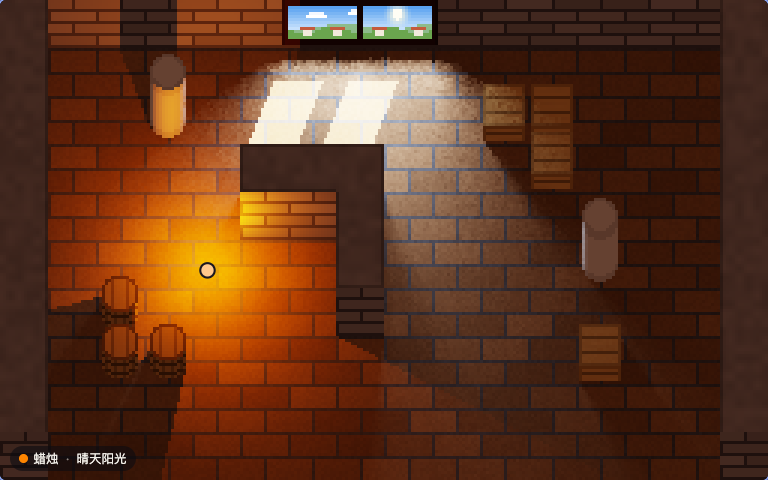

# spectral-pixels

[中文](README.md) | English | [日本語](README.ja.md)

[](https://github.com/FinnChou/spectral-pixels/actions/workflows/build.yml)

2D pixel-art lighting computed wavelength by wavelength. Lights are described by measured or standardized relative
spectral power distributions, materials by measured spectral reflectances of building materials. For every pixel the
two are multiplied and summed over 400–700 nm to give CIE XYZ, which is then converted to sRGB for display.

The engine is a small library written in C11 that can be used directly in your own programs. The same source is
compiled both to a native program and to WebAssembly (about 27 KB, no imports) that runs in the browser, and the two
produce byte-identical output.



- Live demo: <https://finnchou.github.io/spectral-pixels/>
- Write-up on the author's blog (in Chinese): [番外（一）：用光谱给像素小屋打光](https://finnchou.github.io/posts/Spectral-Pixel-Lighting/)

## The demo

- Walk around the room with a lamp using WASD or the arrow keys (or by holding the pointer on the frame). Walls,
  pillars, crates and barrels all cast shadows.
- The lamp offers 8 lights: a Planckian radiator at 1900 K (standing in for a candle), CIE standard illuminant A,
  the high-pressure sodium lamp HP1, the fluorescent lamps FL7 and FL11, the white LEDs B4 and B5, and an RGB LED.
- Outside the window: direct sun, overcast sky, clear sky in the shade, a high-pressure sodium street lamp, or
  closed shutters. The window opening is an area light and casts the shadow of its frame onto the floor.
- The materials of the floor, walls, pillars, crates, barrels and window frame can be changed, from 20 building
  materials measured for KLUM.
- Point anywhere to see the reflectance of the material there, and the spectra of the light arriving at that point
  and of the light it reflects.

The interface of the demo is in Chinese, English and Japanese; switch between them in the corner of the frame.

## Using it in your own program

The engine is a self-contained C11 library: the public interface is [`include/spl.h`](include/spl.h) and the
implementation is the single file `src/spl.c` (plus the generated `src/cmf.h` and `src/srgb_lut.h`). It depends only on
the standard library and libm. Copy these four files into your project, or build the static library `build/libspl.a`
with `make lib`; for a shared library, define `SPL_SHARED` both when building and when using it. The library has no
global state; several engines can exist at the same time.

The engine only works with spectra: the relative spectral power distribution of each light and a table of
reflectances indexed by row. It does not know what the materials are called or what the scene looks like; the caller
tells it, through a few buffers, which surface each pixel shows and which parts of space block light.

| Part | Functions |
|---|---|
| Engine | `spl_create()` from an `spl_config` (width, height, reflectance rows, lights; limits in `SPL_MAX_*`), `spl_destroy()`; `spl_version()` |
| Scene | `spl_surfaces()`: position, normal, reflectance row and texture shade of the surface seen at each pixel<br>`spl_heights()`, `spl_gaps()`, `spl_set_ceiling()`: occluders (a height field with optional openings); call `spl_invalidate()` after changing them |
| Lights | `spl_light_set_spectrum()`; `spl_light_set_point()` point light, `spl_light_set_directional()` directional light, `spl_light_set_area()` parallelogram area light; `spl_light_disable()` |
| Materials and output | `spl_set_reflectance()`, `spl_set_ambient()`, `spl_set_exposure()`; `spl_render()` writes RGBA into a buffer of the caller, `spl_probe()` gives the incident and reflected spectra at a pixel |
| Colour utilities | `spl_light_rgb()` the colour of a light itself, `spl_surface_rgb()` the displayed colour of a surface under a given illuminance; no engine needed |

Functions that can fail return an `spl_status`: an invalid argument (a NULL pointer, an index out of range, a value
that is not finite or outside its documented range) returns `SPL_ERR_ARGUMENT` and leaves the engine unchanged;
`spl_create()` returns `SPL_ERR_MEMORY` when memory runs out. The
conventions for coordinates, units, the normalization of spectra and the geometry cache are in the header of `spl.h`.

The smallest example is [`examples/minimal.c`](examples/minimal.c): an equal-energy light above a 50 % grey floor with a
16 px tall block on it. Its core, without error handling and file output:

```c
spl_config config = { 256, 160, 1, 1 }; /* 256 × 160 pixels, one reflectance row, one light */
spl_engine *engine;
spl_create(&config, &engine);

float light[SPL_NW];
float grey[SPL_NW];
for (int k = 0; k < SPL_NW; k++) {
    light[k] = 1;   /* equal energy */
    grey[k] = 0.5f; /* 50 % reflectance at every wavelength */
}

/* seen from above: every pixel shows the floor or the top of the block */
spl_surface *surfaces = spl_surfaces(engine);
float *heights = spl_heights(engine);
for (int y = 0; y < 160; y++) {
    for (int x = 0; x < 256; x++) {
        int i = y * 256 + x;
        int block = x >= 120 && x < 136 && y >= 72 && y < 88;
        heights[i] = block ? 16 : 0;
        spl_surface s = { { x + 0.5f, y + 0.5f, heights[i] }, { 0, 0, 1 }, 0, 1 };
        surfaces[i] = s;
    }
}
spl_invalidate(engine);

spl_set_reflectance(engine, 0, grey);
spl_light_set_spectrum(engine, 0, light);
spl_light_set_point(engine, 0, 96, 80, 24, 2000);

static uint8_t rgba[256 * 160 * 4];
spl_render(engine, rgba);
spl_destroy(engine);
```

`make example` builds and runs it and writes `build/minimal.ppm`; or compile it directly with
`cc -std=c11 -Iinclude -Isrc examples/minimal.c src/spl.c -lm`. The scene of the demo (oblique projection, pixel
textures, window) is in [`demo/`](demo/); it uses the engine only through `spl.h` and can be read as a fuller example.

The version is given by `SPL_VERSION_MAJOR`, `SPL_VERSION_MINOR`, `SPL_VERSION_PATCH` and `spl_version()`. While the
version is 0.x the interface may still change; every change is recorded in [`CHANGELOG.md`](CHANGELOG.md).

## Files

| Path | Contents |
|---|---|
| `include/spl.h` | The public interface of the library |
| `src/spl.c` | The implementation: spectral sums, illuminance, occlusion, ambient light estimate, tone mapping, sRGB encoding |
| `src/cmf.h`, `src/srgb_lut.h` | Headers generated by `prep`: CIE 1931 colour-matching functions, sRGB quantization thresholds |
| `demo/scene.h`, `demo/scene.c` | The demo scene: map, procedural pixel textures, oblique projection, window; fills the engine's input buffers |
| `demo/wasm.c` | Memory allocation and constants exported additionally by the WebAssembly build |
| `tests/test_spl.c` | Unit tests: argument checks, inverse-square and cosine laws, occlusion, area lights, ambient light, the geometry cache, extreme inputs, independence of engines and more |
| `tests/reference.txt` | SHA-256 of the reference outputs, checked by `make check` |
| `examples/minimal.c` | The smallest complete example |
| `tools/prep.c` | Data preparation: generates the two headers above and the two data files from the CIE data tables and the KLUM library |
| `tools/render.c` | Command-line renderer: produces stills and serves as the reference for the comparison |
| `tools/check.mjs` | Byte-by-byte comparison of the native and WebAssembly builds |
| `tools/data.sha256` | SHA-256 of the raw data |
| `docs/` | The web demo (GitHub Pages): `index.html`, `demo.js`, `demo.css`; the generated `illuminants.txt`, `reflectances.txt`; `GPL-2.0.txt`, the license text copied from KLUM. `make` builds `engine.wasm` here |
| `.github/workflows/build.yml` | CI: runs the unit tests with zig cc, gcc and clang and under sanitizers, builds the library and the example, runs `make check`, and on pushes to main publishes `docs/` with the freshly built `engine.wasm` to GitHub Pages |
| `.clang-format` | Code formatting |
| `CHANGELOG.md` | Record of changes between versions |
| `media/demo.webp` | The animation on this page |

The generated headers and data files are committed, so building does not require the raw data. `engine.wasm` is a build
output and is not committed: build it locally with `make`; the live demo is built and published by CI.

## Building

The default compiler is `zig cc` from [zig](https://ziglang.org/) 0.17.0. The library, the unit tests and the native
tools build with any C11 compiler (for example `make -B test CC=gcc`); the WebAssembly build needs zig, and
`make check` also requires Node.js 18 or later.

```sh
make          # docs/engine.wasm and the native program render
make lib      # the static library build/libspl.a
make test     # unit tests
make sanitize # unit tests under AddressSanitizer and UndefinedBehaviorSanitizer (clang); spl.h compiled as C++
make example  # examples/minimal.c, writes build/minimal.ppm
make check    # compare the native and WebAssembly builds byte by byte, and both with tests/reference.txt
make data     # regenerate the headers and data files from the raw data (see below)
make format   # format the C sources with clang-format
make clean
```

The native and WebAssembly results agree for two reasons: both targets are compiled with `-ffp-contract=off`, so no
multiplication and addition are fused into a single rounding; and the engine and scene use only operations that
IEEE 754 defines exactly (float and double arithmetic, `sqrtf`, `floorf`, `fmodf`, `fabsf`, `fminf`, `fmaxf`, and
conversions between integers and floating point). The sRGB encoding looks up thresholds that `prep` computes in
double precision instead of calling `powf`. When you compile the library in your own project, add
`-ffp-contract=off` if you need byte-identical results across platforms. Without it the results are still correct,
but on platforms with FMA instructions a channel of an occasional pixel may differ by one level.

See the header of `tools/render.c` for the usage of `render`, for example:

```sh
./render docs/illuminants.txt docs/reflectances.txt out.ppm \
  floor=KLUM-B002,KLUM-C001,1 wall=KLUM-G001,KLUM-C001,0 pillar=KLUM-G002,-,0 \
  crate=KLUM-L002,-,0 barrel=KLUM-L002,-,0 frame=KLUM-L001,-,0 \
  light0=point,planck-1900,88,104,18,2000 light1=window,cie-d75,50 exposure=0.5 scale=3 dot=88,104
```

## Raw data

`make data` reads the following files from the `DATA` directory (by default `data/`, which is not under version
control). All were retrieved on 2026-10-31.

| File | Source | DOI / version |
|---|---|---|
| `cie/CIE_xyz_1931_2deg.csv` | CIE 1931 colour-matching functions, 2 degree observer | 10.25039/CIE.DS.xvudnb9b |
| `cie/CIE_std_illum_A_1nm.csv` | CIE standard illuminant A - 1 nm | 10.25039/CIE.DS.8jsxjrsn |
| `cie/CIE_std_illum_D65.csv` | CIE standard illuminant D65 | 10.25039/CIE.DS.hjfjmt59 |
| `cie/CIE_illum_D55.csv` | Relative spectral power distributions of CIE illuminant D55 | 10.25039/CIE.DS.qewfb3kp |
| `cie/CIE_illum_D75.csv` | Relative spectral power distributions of CIE illuminant D75 | 10.25039/CIE.DS.9fvcmrk4 |
| `cie/CIE_illum_Dxx_comp.csv` | Components of the relative spectral distribution of daylight | 10.25039/CIE.DS.w7zunnny |
| `cie/CIE_illum_FLs.csv` | Relative SPDs of illuminants representing typical fluorescent lamps | 10.25039/CIE.DS.ukaymjdn |
| `cie/CIE_illum_LEDs.csv` | Relative SPDs of illuminants representing typical LED lamps | 10.25039/CIE.DS.vgssnyfg |
| `cie/CIE_illum_HPs.csv` | Relative SPDs of high pressure discharge lamp illuminants | 10.25039/CIE.DS.f6rvvnev |
| `klum/KLUM_spectra.csv`, `klum/KLUM_quality.csv`, `klum/LICENSE.txt` | KLUM, Karlsruhe Library of Urban Materials | commit ad68196 |

To download and verify:

```sh
mkdir -p data/cie data/klum
for f in CIE_xyz_1931_2deg CIE_std_illum_A_1nm CIE_std_illum_D65 CIE_illum_D55 CIE_illum_D75 \
         CIE_illum_Dxx_comp CIE_illum_FLs CIE_illum_LEDs CIE_illum_HPs; do
  curl -fsSL -o data/cie/$f.csv https://files.cie.co.at/Publications-datasets/$f.csv
done
for f in KLUM_spectra.csv KLUM_quality.csv LICENSE.txt; do
  curl -fsSL -o data/klum/$f \
    https://raw.githubusercontent.com/rebeccailehag/KLUM_library/ad68196296cce2b5b62382f5a72554191056fa77/$f
done
(cd data && shasum -a 256 -c ../tools/data.sha256)   # on Linux: sha256sum -c
make data && git diff --exit-code                    # must reproduce the committed files exactly
```

The catalogue of CIE data tables is at <https://cie.co.at/data-tables>.

## Methods and references

- Colorimetry: CIE 015:2018 *Colorimetry*, 4th ed., doi:10.25039/TR.015.2018, with the CIE 1931 2° standard observer.
- CIE daylight (10000 K): synthesized from S0, S1 and S2 following CIE 015:2018.
- Planckian radiator: c2 = 1.4388 × 10⁻² m·K (ITS-90; H. Preston-Thomas, *Metrologia* 27(1):3–10, 1990,
  doi:10.1088/0026-1394/27/1/002).
- sRGB: IEC 61966-2-1:1999.
- Tone mapping: K. Narkowicz, “ACES Filmic Tone Mapping Curve”, 2016-01-06,
  <https://knarkowicz.wordpress.com/2016/01/06/aces-filmic-tone-mapping-curve/>.
- Ambient light: estimated from room averages with the integrating-sphere relation, which also underlies the ambient
  term of M. F. Cohen, S. E. Chen, J. R. Wallace, D. P. Greenberg, “A Progressive Refinement Approach to Fast Radiosity
  Image Generation”, *Computer Graphics* 22(4):75–84, 1988, doi:10.1145/378456.378487.
- Reflectances of building materials: R. Ilehag, A. Schenk, Y. Huang, S. Hinz, “KLUM: An Urban VNIR and SWIR Spectral
  Library Consisting of Building Materials”, *Remote Sensing* 11(18):2149, 2019, doi:10.3390/rs11182149.

The header of `tools/prep.c` documents how the data are processed (sampling, averaging, selection).

## Simplifications and known limitations

- All surfaces are Lambertian. Textures only scale the reflectance; they do not change its spectral shape.
- Ambient light is an integrating-sphere (room-average) estimate: the same for every surface, without occlusion and
  without the colour shift caused by interreflection.
- The spectral range is 400–700 nm; the colour-matching functions outside it are not included.
- There is no white balancing; lights appear in their own colour. Components outside the sRGB gamut are clipped to 0.
- Occluders are rasterized at 1 px. Point and directional lights cast hard shadows with jagged edges, and light passing
  through a very narrow gap between two objects shows up as a broken thin line.
- The demo room is fixed at 256 × 160 pixels. Its south side has no wall and is open for occlusion as well. The view
  drawn in the window opening is a stylized picture and takes no part in the computation.
- One engine must not be used from two threads at the same time; separate engines do not affect each other.

## Embedding

```html
<link rel="stylesheet" href="<base>/demo.css">
<div class="spl-demo" data-base="<base>/"></div>
<script src="<base>/demo.js" defer></script>
```

`data-base` is the directory that holds `engine.wasm` and the two data files. Build `engine.wasm` with `make`, or take the
one served with the live demo, <https://finnchou.github.io/spectral-pixels/engine.wasm>. The interface starts in Chinese;
`data-lang="en"` or `data-lang="ja"` starts it in English or Japanese. Interface colours follow the CSS
variables of the host page (`--card-bg`, `--text-color`, `--text-muted-color`, `--main-border-color`) and fall back
to a light theme.

## Contributing

Issues and pull requests are welcome. Before submitting, run `make format`, `make test`, `make sanitize` and
`make check`. Any change to the rendered output should be intentional: `make check` reports it as a difference; once it
is confirmed, update `tests/reference.txt` with `node tools/check.mjs --update` and say in the description which
outputs change and why. Changes to the interface go into `CHANGELOG.md`.

## License

Except for the data files listed below, the contents of this repository are released under the [MIT](LICENSE)
license, © 2026 FinnZhou: you may use, modify and redistribute them freely, including commercially, as long as the
copyright notice and the license text are kept.

- `src/cmf.h` and `docs/illuminants.txt` contain CIE data and are distributed under
  [CC BY-SA 4.0](https://creativecommons.org/licenses/by-sa/4.0/). Every program compiled from `src/spl.c`
  (`libspl.a`, `engine.wasm`, `render`, or your own) includes `cmf.h`; that data remains under CC BY-SA 4.0, so keep the
  attribution to the CIE and the license link when redistributing it.
- `docs/reflectances.txt` contains KLUM data and is distributed under GPL-2.0; the full license text is in
  [`docs/GPL-2.0.txt`](docs/GPL-2.0.txt). The file is plain text and thus in source form; `tools/prep.c` reproduces it
  from the pinned upstream commit.
