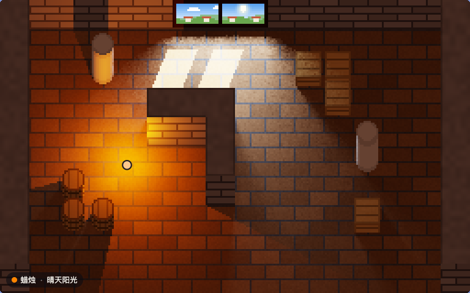

# spectral-pixels

[中文](README.md) | [English](README.en.md) | 日本語

[](https://github.com/FinnChou/spectral-pixels/actions/workflows/build.yml)

波長ごとに計算する 2D ピクセルアートのライティング。光源は実測または規格化された相対分光分布で、材料は実測された建材の分光反射率で
表す。各ピクセルで両者を 400–700 nm にわたって掛け合わせて積分し、CIE XYZ を求めてから sRGB に変換して表示する。

エンジンは C で書かれている。同じソースからネイティブプログラムと WebAssembly（約 21 KB、インポートなし）の両方を
ビルドし、後者はブラウザで動く。両者の出力はバイト単位で一致する。



- オンラインデモ：<https://finnchou.github.io/spectral-pixels/>
- 作者のブログ（中国語）：[Finn's blog](https://finnchou.github.io/)

## デモでできること

- WASD または矢印キー（画面を押し続けてもよい）で、ランプを持って部屋の中を歩ける。壁、石柱、木箱、樽はすべて影を落とす。
- ランプの光源は 8 種類：プランク放射体（1900 K、ろうそくの代わり）、CIE 標準イルミナント A、高圧ナトリウムランプ HP1、
  蛍光ランプ FL7 と FL11、白色 LED B4 と B5、RGB LED。
- 窓の外は、晴天の直射日光、曇天、晴天の日陰、高圧ナトリウムランプの街灯、よろい戸を閉めた状態から選べる。窓の開口を
  面光源として扱い、床に窓枠の影を落とす。
- 床、壁、石柱、木箱、樽、窓枠の材料は、KLUM で実測された 20 種類の建材から選べる。
- ポインタを置いた場所の材料の反射率と、その点に届く光および反射される光のスペクトルを表示する。

デモの UI は中国語である。

## エンジン

エンジンが扱うのはスペクトルだけ、すなわち各光源の相対分光分布と、行番号で引く反射率の表である。材料の名前も
シーンの形も知らない。各ピクセルにどの面が見えているか、空間のどこが光を遮るかは、呼び出し側がいくつかのバッファで
伝える。インターフェースはすべて [`src/light.h`](src/light.h) にある。

| 部分 | 関数 |
|---|---|
| シーン | `light_surfaces()`：各ピクセルに見える面の位置、法線、反射率の行番号、テクスチャの明暗<br>`light_heights()`、`light_gaps()`、`light_set_ceiling()`：遮蔽物（開口を持てる高さ場） |
| 光源（最大 8 個） | `light_set_spectrum()`；`light_point()` 点光源、`light_sun()` 平行光源、`light_area()` 平行四辺形の面光源；`light_off()` |
| 材料と出力 | `light_set_reflectance()`、`light_set_ambient()`、`light_set_exposure()`；`light_render()` は RGBA を、`light_probe()` は 1 点の入射・反射スペクトルを返す |

最小の例：反射率 50 % のグレーの床を等エネルギー光源で照らし、床の上に高さ 16 px のブロックを置く。

```c
#include "light.h"

int main(void) {
  float spd[LIGHT_NW], refl[LIGHT_NW];
  for (int i = 0; i < LIGHT_NW; i++) { spd[i] = 1; refl[i] = 0.5f; }   /* 等エネルギー光源、50 % グレー */

  LightSurface *s = light_surfaces();
  float *h = light_heights();
  for (int y = 0; y < LIGHT_H; y++)
    for (int x = 0; x < LIGHT_W; x++) {
      int i = y * LIGHT_W + x, block = x >= 120 && x < 136 && y >= 72 && y < 88;
      h[i] = block ? 16 : 0;                                           /* 高さ 16 px のブロック */
      s[i] = (LightSurface){ { x + 0.5f, y + 0.5f, h[i] }, { 0, 0, 1 }, 0, 1 };  /* 真上から見た上面のみ */
    }
  light_invalidate();

  light_set_reflectance(0, refl);
  light_set_spectrum(0, spd);
  light_point(0, 96, 80, 24, 2000);
  const unsigned char *rgba = light_render();                          /* LIGHT_W × LIGHT_H × RGBA */
  return rgba[0] == 0;
}
```

`zig cc -std=c11 -Isrc example.c src/light.c -lm` でコンパイルできる。デモのシーン（斜投影、ピクセルテクスチャ、窓）は
[`src/scene.c`](src/scene.c) にある。これはエンジンを呼び出す側であり、エンジンの一部ではない。

## ファイル

| パス | 内容 |
|---|---|
| `src/light.h`、`src/light.c` | エンジン：スペクトルの積和、照度、遮蔽、環境光の推定、トーンマッピング、sRGB 符号化 |
| `src/scene.h`、`src/scene.c` | デモのシーン：マップ、手続き的に生成するピクセルテクスチャ、斜投影、窓。エンジンの入力バッファを埋める |
| `src/cmf.h`、`src/srgb_lut.h` | `prep` が生成するヘッダ：CIE 1931 等色関数、sRGB の量子化しきい値 |
| `tools/prep.c` | データの前処理：CIE データ表と KLUM ライブラリから、上の 2 つのヘッダと 2 つのデータファイルを生成する |
| `tools/render.c` | コマンドラインのレンダラ：静止画を出力し、比較の基準にもなる |
| `tools/check.mjs` | ネイティブ版と WebAssembly 版のバイト単位の比較 |
| `tools/data.sha256` | 元データの SHA-256 |
| `docs/` | ウェブ版デモ（GitHub Pages）：`index.html`、`demo.js`、`demo.css`；生成物の `illuminants.txt`、`reflectances.txt`；KLUM から複製したライセンス全文 `GPL-2.0.txt`。`make` は `engine.wasm` をここに出力する |
| `.github/workflows/build.yml` | CI：ビルドと `make check` を行い、main へのプッシュ時には `docs/` をビルドした `engine.wasm` とともに GitHub Pages へ公開する |
| `media/demo.webp` | このページのアニメーション |

生成したヘッダとデータファイルはコミットしてあるので、元データがなくてもビルドできる。`engine.wasm` はビルド成果物なので
コミットしない。手元では `make` でビルドし、オンラインデモは CI がビルドして公開する。

## ビルド

ビルドには [zig](https://ziglang.org/) 0.17.0（`zig cc` を使う）が、`make check` にはさらに Node.js 18 以降が必要である。

```sh
make          # docs/engine.wasm とネイティブプログラム render
make check    # ネイティブ版と WebAssembly 版をバイト単位で比較
make data     # 元データからヘッダとデータファイルを再生成（次節を参照）
make clean
```

ネイティブ版と WebAssembly 版の結果が一致する理由は 2 つある。1 つは、両方のターゲットを `-ffp-contract=off` で
コンパイルし、乗算と加算を 1 回の丸めにまとめないことである。もう 1 つは、エンジンとシーンが IEEE 754 で厳密に定義された
演算（float と double の四則演算、`sqrtf`、`floorf`、`fmodf`、`fabsf`、`fminf`、`fmaxf`、整数と浮動小数点数の間の変換）
だけを使うことである。sRGB の符号化では `powf` を呼ばず、`prep` が倍精度で前もって計算したしきい値の表を引く。

`render` の使い方は `tools/render.c` の冒頭にある。例：

```sh
./render docs/illuminants.txt docs/reflectances.txt out.ppm \
  floor=KLUM-B002,KLUM-C001,1 wall=KLUM-G001,KLUM-C001,0 pillar=KLUM-G002,-,0 \
  crate=KLUM-L002,-,0 barrel=KLUM-L002,-,0 frame=KLUM-L001,-,0 \
  light0=point,planck-1900,88,104,18,2000 light1=window,cie-d75,50 exposure=0.5 scale=3 dot=88,104
```

## 元データ

`make data` は `DATA` ディレクトリ（既定は `data/`、バージョン管理の対象外）から次のファイルを読む。いずれも
2026-10-31 に取得した。

| ファイル | 出典 | DOI / バージョン |
|---|---|---|
| `cie/CIE_xyz_1931_2deg.csv` | CIE 1931 colour-matching functions, 2 degree observer | 10.25039/CIE.DS.xvudnb9b |
| `cie/CIE_std_illum_A_1nm.csv` | CIE standard illuminant A - 1 nm | 10.25039/CIE.DS.8jsxjrsn |
| `cie/CIE_std_illum_D65.csv` | CIE standard illuminant D65 | 10.25039/CIE.DS.hjfjmt59 |
| `cie/CIE_illum_D55.csv` | Relative spectral power distributions of CIE illuminant D55 | 10.25039/CIE.DS.qewfb3kp |
| `cie/CIE_illum_D75.csv` | Relative spectral power distributions of CIE illuminant D75 | 10.25039/CIE.DS.9fvcmrk4 |
| `cie/CIE_illum_Dxx_comp.csv` | Components of the relative spectral distribution of daylight | 10.25039/CIE.DS.w7zunnny |
| `cie/CIE_illum_FLs.csv` | Relative SPDs of illuminants representing typical fluorescent lamps | 10.25039/CIE.DS.ukaymjdn |
| `cie/CIE_illum_LEDs.csv` | Relative SPDs of illuminants representing typical LED lamps | 10.25039/CIE.DS.vgssnyfg |
| `cie/CIE_illum_HPs.csv` | Relative SPDs of high pressure discharge lamp illuminants | 10.25039/CIE.DS.f6rvvnev |
| `klum/KLUM_spectra.csv`、`klum/KLUM_quality.csv`、`klum/LICENSE.txt` | KLUM（Karlsruhe Library of Urban Materials） | コミット ad68196 |

ダウンロードと検証：

```sh
mkdir -p data/cie data/klum
for f in CIE_xyz_1931_2deg CIE_std_illum_A_1nm CIE_std_illum_D65 CIE_illum_D55 CIE_illum_D75 \
         CIE_illum_Dxx_comp CIE_illum_FLs CIE_illum_LEDs CIE_illum_HPs; do
  curl -fsSL -o data/cie/$f.csv https://files.cie.co.at/Publications-datasets/$f.csv
done
for f in KLUM_spectra.csv KLUM_quality.csv LICENSE.txt; do
  curl -fsSL -o data/klum/$f \
    https://raw.githubusercontent.com/rebeccailehag/KLUM_library/ad68196296cce2b5b62382f5a72554191056fa77/$f
done
(cd data && shasum -a 256 -c ../tools/data.sha256)   # Linux では sha256sum -c
make data && git diff --exit-code                    # コミット済みの生成物と完全に一致する
```

CIE データ表の一覧は <https://cie.co.at/data-tables> にある。

## 手法と参考文献

- 測色：CIE 015:2018 *Colorimetry*, 4th ed., doi:10.25039/TR.015.2018。等色関数は CIE 1931 2° 標準観測者。
- CIE 昼光（10000 K）：CIE 015:2018 の方法に従い S0、S1、S2 から合成。
- プランク放射体：c2 = 1.4388 × 10⁻² m·K（ITS-90；H. Preston-Thomas, *Metrologia* 27(1):3–10, 1990, doi:10.1088/0026-1394/27/1/002）。
- sRGB：IEC 61966-2-1:1999。
- トーンマッピング：K. Narkowicz, “ACES Filmic Tone Mapping Curve”, 2016-01-06,
  <https://knarkowicz.wordpress.com/2016/01/06/aces-filmic-tone-mapping-curve/>。
- 環境光の推定：積分球の関係式を室内の平均値に当てはめる。M. F. Cohen, S. E. Chen, J. R. Wallace, D. P. Greenberg,
  “A Progressive Refinement Approach to Fast Radiosity Image Generation”, *Computer Graphics* 22(4):75–84, 1988,
  doi:10.1145/378456.378487 の環境項も同じ関係に基づく。
- 建材の反射率：R. Ilehag, A. Schenk, Y. Huang, S. Hinz, “KLUM: An Urban VNIR and SWIR Spectral Library Consisting of
  Building Materials”, *Remote Sensing* 11(18):2149, 2019, doi:10.3390/rs11182149。

データ処理の詳細（サンプリング、平均、採否）は `tools/prep.c` の冒頭にある。

## 簡略化と既知の制限

- すべての面を完全拡散反射面（ランバート面）として扱う。テクスチャは反射率の明暗を変えるだけで、スペクトルの形は変えない。
- 環境光は積分球（室内平均）による推定で、すべての面で同じ値になる。遮蔽も、相互反射による色の偏りも考慮しない。
- スペクトル範囲は 400–700 nm で、この範囲外の等色関数は計算に含めない。
- ホワイトバランスは行わず、光源はそれ自体の色で表示される。sRGB の色域外の成分は 0 に切り詰める。
- 遮蔽物は 1 px 単位でラスタライズする。点光源と平行光源の影は硬く、縁はギザギザになる。また、2 つの物体のごく狭い
  隙間を通る光は、途切れた細い線として現れる。
- デモの部屋の南側には壁がなく、遮蔽計算でも開放として扱う。窓の開口に描く外の景色は様式化した絵で、計算には関与しない。
- エンジンは単一インスタンスで、再入可能ではない。返されるポインタは内部の静的バッファを指す。

## ウェブページへの埋め込み

```html
<link rel="stylesheet" href="<base>/demo.css">
<div class="spl-demo" data-base="<base>/"></div>
<script src="<base>/demo.js" defer></script>
```

`data-base` には `engine.wasm` と 2 つのデータファイルがあるディレクトリを指定する。`engine.wasm` は `make` でビルドするか、
オンラインデモが配信しているもの（<https://finnchou.github.io/spectral-pixels/engine.wasm>）を使う。UI の色はホストページの CSS 変数
（`--card-bg`、`--text-color`、`--text-muted-color`、`--main-border-color`）に従い、定義がなければライトテーマの値を使う。

## ライセンス

下記のデータファイルを除き、このリポジトリの内容は [MIT](LICENSE) ライセンス、© 2026 FinnZhou で公開する。著作権表示と
ライセンス文を残せば、商用を含めて自由に使用・改変・再配布できる。

- `src/cmf.h` と `docs/illuminants.txt` は CIE のデータを含み、[CC BY-SA 4.0](https://creativecommons.org/licenses/by-sa/4.0/)
  で配布する。`src/light.c` からビルドしたプログラム（`engine.wasm`、`render`、利用者自身のプログラム）にはすべて `cmf.h`
  が組み込まれる。このデータは引き続き CC BY-SA 4.0 に従うため、再配布の際は CIE のクレジットとライセンスへのリンクを残すこと。
- `docs/reflectances.txt` は KLUM のデータを含み、GPL-2.0 で配布する。ライセンス全文は [`docs/GPL-2.0.txt`](docs/GPL-2.0.txt) にある。
  このファイルはプレーンテキストでそれ自体がソース形式であり、`tools/prep.c` によって上流の固定コミットのデータから再現できる。
