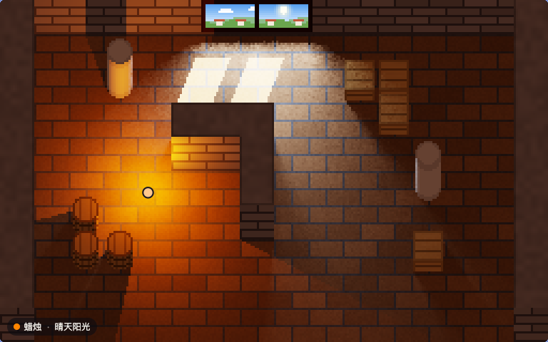

# spectral-pixels

中文 | [English](README.en.md) | [日本語](README.ja.md)

[](https://github.com/FinnChou/spectral-pixels/actions/workflows/build.yml)

逐波长计算的 2D 像素打光。光源用实测或标准化的相对光谱功率分布描述，材料用实测的建材光谱反射率描述；
每个像素在 400–700 nm 上逐波长相乘、积分得到 CIE XYZ，再转换为 sRGB 显示。

引擎以 C 编写，同一份源码既编译为本机程序，也编译为 WebAssembly（约 21 KB，无导入）在浏览器中运行，
两者的输出逐字节一致。



- 在线试玩：<https://finnchou.github.io/spectral-pixels/>
- 作者的博客：[Finn's blog](https://finnchou.github.io/)

## 演示里能做什么

- 用 WASD 或方向键（也可以按住画面）带着提灯在屋里走动，墙、石柱、木箱、木桶都会挡光。
- 提灯可选 8 种光源：普朗克辐射体（1900 K，当作烛光）、CIE 标准照明体 A、高压钠灯 HP1、荧光灯 FL7 与 FL11、
  白光 LED B4 与 B5、RGB LED。
- 窗外可选晴天阳光、阴天、晴天背阴、高压钠路灯，或者关窗。窗洞作为面光源，在地上投出窗格的影子。
- 地板、墙、石柱、木箱、木桶、窗框的材料都可以换，共 20 种 KLUM 实测建材。
- 指针移到哪里，就显示那里材料的反射率，以及照到那一点的光谱和反射出来的光谱。

## 引擎

引擎只认光谱：每个光源的相对光谱功率分布，以及一张按行编号的反射率表。它不知道材料叫什么，也不知道场景长什么样；
调用方通过几个缓冲区告诉它每个像素看到的是哪个表面、空间里哪些地方挡光。接口全部在
[`src/light.h`](src/light.h)。

| 部分 | 接口 |
|---|---|
| 场景 | `light_surfaces()`：每个像素可见表面的位置、法线、反射率行号、纹理明暗<br>`light_heights()`、`light_gaps()`、`light_set_ceiling()`：遮挡（高度场，可开洞）|
| 光源（至多 8 个）| `light_set_spectrum()`；`light_point()` 点光源、`light_sun()` 平行光、`light_area()` 平行四边形面光源；`light_off()` |
| 材料与输出 | `light_set_reflectance()`、`light_set_ambient()`、`light_set_exposure()`；`light_render()` 输出 RGBA，`light_probe()` 给出一点的入射与反射光谱 |

最小的例子：一盏等能光源照在 50% 灰的地面上，地上有一个 16 px 高的方块。

```c
#include "light.h"

int main(void) {
  float spd[LIGHT_NW], refl[LIGHT_NW];
  for (int i = 0; i < LIGHT_NW; i++) { spd[i] = 1; refl[i] = 0.5f; }   /* 等能光源，50% 灰 */

  LightSurface *s = light_surfaces();
  float *h = light_heights();
  for (int y = 0; y < LIGHT_H; y++)
    for (int x = 0; x < LIGHT_W; x++) {
      int i = y * LIGHT_W + x, block = x >= 120 && x < 136 && y >= 72 && y < 88;
      h[i] = block ? 16 : 0;                                           /* 16 px 高的方块 */
      s[i] = (LightSurface){ { x + 0.5f, y + 0.5f, h[i] }, { 0, 0, 1 }, 0, 1 };  /* 俯视：只看顶面 */
    }
  light_invalidate();

  light_set_reflectance(0, refl);
  light_set_spectrum(0, spd);
  light_point(0, 96, 80, 24, 2000);
  const unsigned char *rgba = light_render();                          /* LIGHT_W × LIGHT_H × RGBA */
  return rgba[0] == 0;
}
```

`zig cc -std=c11 -Isrc example.c src/light.c -lm` 即可编译。演示用的场景（斜投影、像素纹理、窗）在
[`src/scene.c`](src/scene.c)，它是引擎的一个调用方，不属于引擎。

## 文件

| 路径 | 内容 |
|---|---|
| `src/light.h`、`src/light.c` | 引擎：光谱积分、照度、遮挡、环境光估计、色调映射、sRGB 编码 |
| `src/scene.h`、`src/scene.c` | 演示场景：地图、程序生成的像素纹理、斜投影、窗；填写引擎的输入缓冲区 |
| `src/cmf.h`、`src/srgb_lut.h` | 由 `prep` 生成的头文件：CIE 1931 配色函数，sRGB 量化阈值 |
| `tools/prep.c` | 数据预处理：由 CIE 数据表与 KLUM 光谱库生成上面两个头文件与两个数据文件 |
| `tools/render.c` | 命令行渲染程序：出图，并作为比对的基准 |
| `tools/check.mjs` | 本机版与 WebAssembly 版的逐字节比对 |
| `tools/data.sha256` | 原始数据的 SHA-256 |
| `docs/` | 网页演示（GitHub Pages）：`index.html`、`demo.js`、`demo.css`；生成的 `illuminants.txt`、`reflectances.txt`；从 KLUM 复制的许可证全文 `GPL-2.0.txt`。`make` 把 `engine.wasm` 编译到这里 |
| `.github/workflows/build.yml` | CI：编译、运行 `make check`，推送到 main 时把 `docs/` 连同编译出的 `engine.wasm` 发布到 GitHub Pages |
| `media/demo.webp` | 本页的动图 |

生成的头文件与数据文件随源码提交，不必下载原始数据就能构建。`engine.wasm` 是编译产物，不提交：本地用 `make`
编译，在线演示由 CI 编译后发布。

## 构建

需要 [zig](https://ziglang.org/) 0.17.0（使用其中的 `zig cc`）；`make check` 另需 Node.js 18 或更新版本。

```sh
make          # docs/engine.wasm 与本机程序 render
make check    # 本机版与 WebAssembly 版逐字节比对
make data     # 由原始数据重新生成头文件与数据文件（见下节）
make clean
```

本机与 WebAssembly 的结果一致依赖两点：两个目标都以 `-ffp-contract=off` 编译，不把乘法与加法合并为一次舍入；
引擎与场景只使用 IEEE 754 有精确定义的运算（float 与 double 的四则运算、`sqrtf`、`floorf`、`fmodf`、`fabsf`、
`fminf`、`fmaxf`，以及整数与浮点数之间的转换），sRGB 编码查 `prep` 以双精度预先算好的阈值表，不调用 `powf`。

`render` 的用法见 `tools/render.c` 的文件头，例如：

```sh
./render docs/illuminants.txt docs/reflectances.txt out.ppm \
  floor=KLUM-B002,KLUM-C001,1 wall=KLUM-G001,KLUM-C001,0 pillar=KLUM-G002,-,0 \
  crate=KLUM-L002,-,0 barrel=KLUM-L002,-,0 frame=KLUM-L001,-,0 \
  light0=point,planck-1900,88,104,18,2000 light1=window,cie-d75,50 exposure=0.5 scale=3 dot=88,104
```

## 原始数据

`make data` 读取 `DATA` 目录（默认 `data/`，不纳入版本管理）下的文件，均于 2026-10-31 获取：

| 文件 | 来源 | DOI / 版本 |
|---|---|---|
| `cie/CIE_xyz_1931_2deg.csv` | CIE 1931 colour-matching functions, 2 degree observer | 10.25039/CIE.DS.xvudnb9b |
| `cie/CIE_std_illum_A_1nm.csv` | CIE standard illuminant A - 1 nm | 10.25039/CIE.DS.8jsxjrsn |
| `cie/CIE_std_illum_D65.csv` | CIE standard illuminant D65 | 10.25039/CIE.DS.hjfjmt59 |
| `cie/CIE_illum_D55.csv` | Relative spectral power distributions of CIE illuminant D55 | 10.25039/CIE.DS.qewfb3kp |
| `cie/CIE_illum_D75.csv` | Relative spectral power distributions of CIE illuminant D75 | 10.25039/CIE.DS.9fvcmrk4 |
| `cie/CIE_illum_Dxx_comp.csv` | Components of the relative spectral distribution of daylight | 10.25039/CIE.DS.w7zunnny |
| `cie/CIE_illum_FLs.csv` | Relative SPDs of illuminants representing typical fluorescent lamps | 10.25039/CIE.DS.ukaymjdn |
| `cie/CIE_illum_LEDs.csv` | Relative SPDs of illuminants representing typical LED lamps | 10.25039/CIE.DS.vgssnyfg |
| `cie/CIE_illum_HPs.csv` | Relative SPDs of high pressure discharge lamp illuminants | 10.25039/CIE.DS.f6rvvnev |
| `klum/KLUM_spectra.csv`、`klum/KLUM_quality.csv`、`klum/LICENSE.txt` | KLUM 城市建材光谱库 | 提交 ad68196 |

下载并核对：

```sh
mkdir -p data/cie data/klum
for f in CIE_xyz_1931_2deg CIE_std_illum_A_1nm CIE_std_illum_D65 CIE_illum_D55 CIE_illum_D75 \
         CIE_illum_Dxx_comp CIE_illum_FLs CIE_illum_LEDs CIE_illum_HPs; do
  curl -fsSL -o data/cie/$f.csv https://files.cie.co.at/Publications-datasets/$f.csv
done
for f in KLUM_spectra.csv KLUM_quality.csv LICENSE.txt; do
  curl -fsSL -o data/klum/$f \
    https://raw.githubusercontent.com/rebeccailehag/KLUM_library/ad68196296cce2b5b62382f5a72554191056fa77/$f
done
(cd data && shasum -a 256 -c ../tools/data.sha256)   # Linux：sha256sum -c
make data && git diff --exit-code                    # 应与提交的生成物完全一致
```

CIE 数据表的目录见 <https://cie.co.at/data-tables>。

## 方法与参考文献

- 色度计算：CIE 015:2018 *Colorimetry*, 4th ed., doi:10.25039/TR.015.2018。配色函数为 CIE 1931 2° 标准色度观察者。
- CIE 日光（10000 K）：按 CIE 015:2018 的方法由 S0、S1、S2 合成。
- 普朗克辐射体：c2 = 1.4388 × 10⁻² m·K（ITS-90；H. Preston-Thomas, *Metrologia* 27(1):3–10, 1990, doi:10.1088/0026-1394/27/1/002）。
- sRGB：IEC 61966-2-1:1999。
- 色调映射：K. Narkowicz, “ACES Filmic Tone Mapping Curve”, 2016-01-06,
  <https://knarkowicz.wordpress.com/2016/01/06/aces-filmic-tone-mapping-curve/>。
- 环境光估计：按积分球的关系用房间平均值估计，与 M. F. Cohen, S. E. Chen, J. R. Wallace, D. P. Greenberg, “A Progressive
  Refinement Approach to Fast Radiosity Image Generation”, *Computer Graphics* 22(4):75–84, 1988,
  doi:10.1145/378456.378487 中的环境项同理。
- 建材反射率：R. Ilehag, A. Schenk, Y. Huang, S. Hinz, “KLUM: An Urban VNIR and SWIR Spectral Library Consisting of
  Building Materials”, *Remote Sensing* 11(18):2149, 2019, doi:10.3390/rs11182149。

数据的处理细节（采样、平均、取舍）见 `tools/prep.c` 的文件头。

## 简化与已知限制

- 表面均按朗伯漫反射处理；纹理只调节反射率的明暗，不改变光谱形状。
- 环境光按积分球（房间平均）估计，对所有表面相同，不计遮挡，也不计多次反射造成的色偏。
- 光谱范围限于 400–700 nm，配色函数在此范围外的部分未计入。
- 不做白平衡，画面显示光源自身的颜色；超出 sRGB 色域的分量截为 0。
- 遮挡物按 1 px 栅格化。点光源与平行光是硬阴影，边缘有锯齿；两个物体之间很窄的缝漏过的光会呈断续的细线。
- 演示场景的南侧不砌墙，遮挡计算中同样开敞；窗洞内显示的窗外景色是风格化的画，不参与计算。
- 引擎为单实例，不可重入；返回的指针指向内部静态缓冲区。

## 嵌入网页

```html
<link rel="stylesheet" href="<base>/demo.css">
<div class="spl-demo" data-base="<base>/"></div>
<script src="<base>/demo.js" defer></script>
```

`data-base` 指向 `engine.wasm` 与两个数据文件所在的目录。`engine.wasm` 需先用 `make` 编译，也可以直接取在线演示里的
<https://finnchou.github.io/spectral-pixels/engine.wasm>。界面文字为中文。界面颜色跟随宿主页面的 CSS 变量
（`--card-bg`、`--text-color`、`--text-muted-color`、`--main-border-color`），没有这些变量时使用浅色的后备值。

## 许可

除下列数据文件外，本仓库的内容按 [MIT](LICENSE) 发布，© 2026 FinnZhou：可以自由使用、修改、再发布，包括商用，
只需保留版权声明与许可文本。

- `src/cmf.h`、`docs/illuminants.txt` 含 CIE 数据，按 [CC BY-SA 4.0](https://creativecommons.org/licenses/by-sa/4.0/) 发布。
  由 `src/light.c` 编译出的程序（`engine.wasm`、`render` 以及你自己的程序）都编入了 `cmf.h`，这部分数据仍受
  CC BY-SA 4.0 约束，再发布时须保留 CIE 的署名与许可链接。
- `docs/reflectances.txt` 含 KLUM 数据，按 GPL-2.0 发布，许可证全文见 [`docs/GPL-2.0.txt`](docs/GPL-2.0.txt)。
  该文件是纯文本，本身即为源码形式，可由 `tools/prep.c` 从上游固定提交的数据复现。
